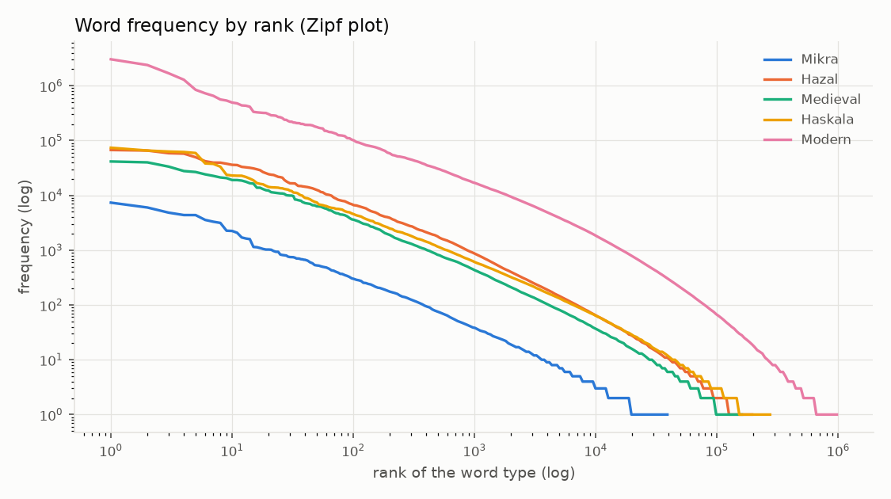
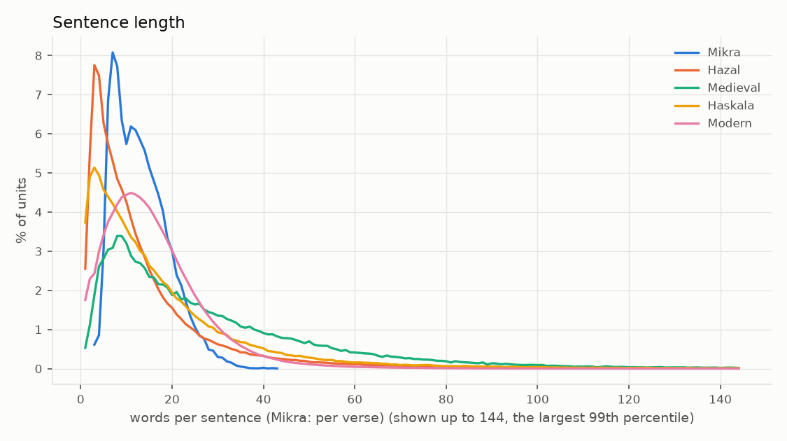
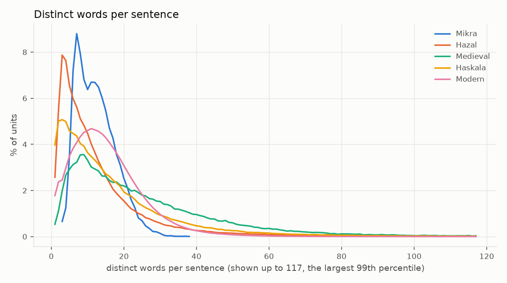
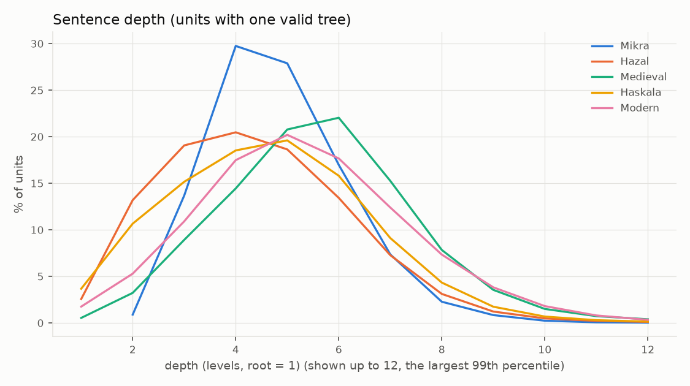
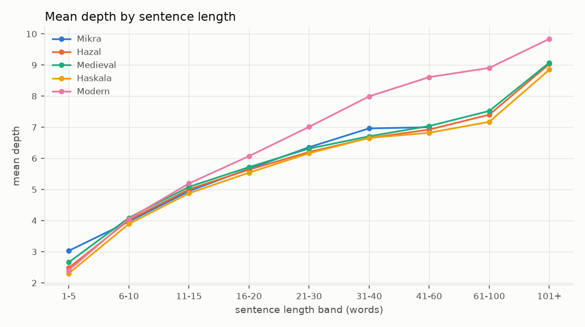
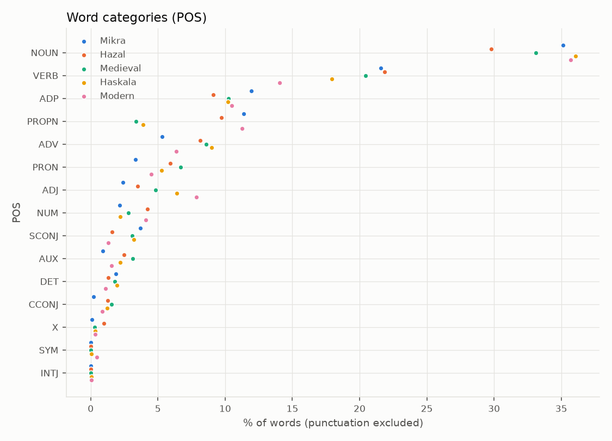
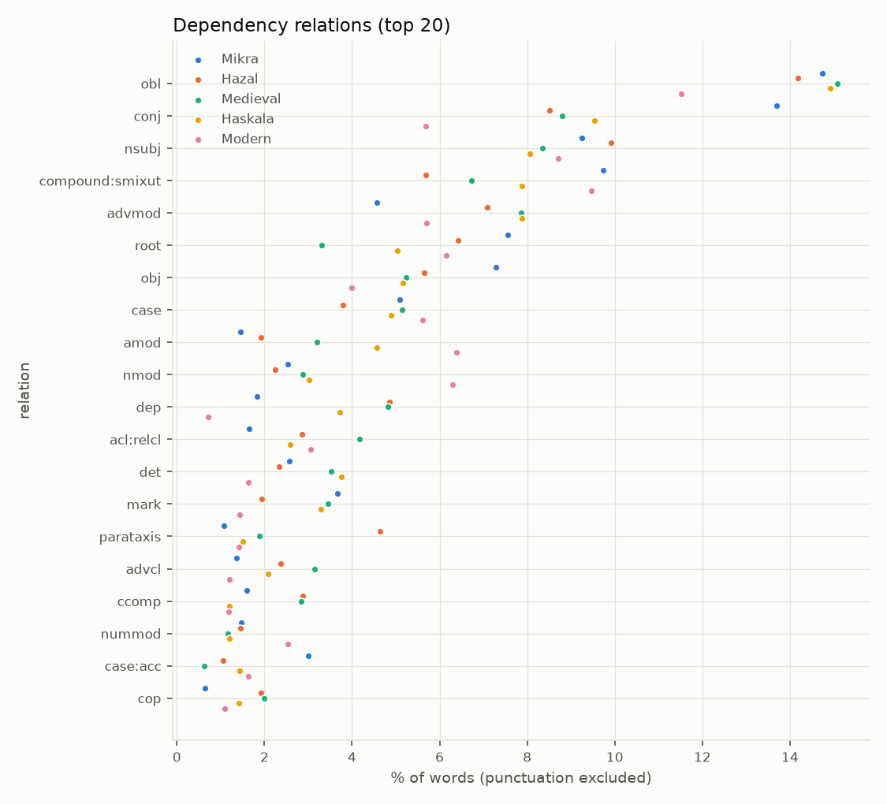

# Descriptive Statistics of the Five Corpora (project.pdf §4)

*Generated by `hebloc stats` from `data/stats/final-20261116-565826e3c1` (status **final**, code `2d632eff1af1`, 2026-11-16T10:17:16+00:00). Design and definitions: `docs/m6_design.md` (D-046). View: full view (D-015).*

Runs: Mikra: `mikra/base-topk-v1__mikra`; Hazal: `hazal/base-topk-v1__hazal`; Medieval: `medieval/base-topk-v1__medieval`; Haskala: `haskala/base-topk-v1__haskala`; Modern: `modern/base-topk-v1__modern-a7`, `modern/base-topk-v1__modern-blogs`, `modern/base-topk-v1__modern-haaretz-b00`, `modern/base-topk-v1__modern-haaretz-b01`, `modern/base-topk-v1__modern-haaretz-b02`, `modern/base-topk-v1__modern-haaretz-b03`, `modern/base-topk-v1__modern-haaretz-b04`, `modern/base-topk-v1__modern-haaretz-b05`, `modern/base-topk-v1__modern-haaretz-b06`, `modern/base-topk-v1__modern-haaretz-b07`, `modern/base-topk-v1__modern-haaretz-b08`, `modern/base-topk-v1__modern-haaretz-b09`, `modern/base-topk-v1__modern-haaretz-b10`, `modern/base-topk-v1__modern-haaretz-b11`, `modern/base-topk-v1__modern-haaretz-b12`, `modern/base-topk-v1__modern-haaretz-b13`, `modern/base-topk-v1__modern-haaretz-b14`, `modern/base-topk-v1__modern-haaretz-b15`, `modern/base-topk-v1__modern-haaretz-b16`, `modern/base-topk-v1__modern-haaretz-b17`, `modern/base-topk-v1__modern-haaretz-b18`, `modern/base-topk-v1__modern-haaretz-b19`, `modern/base-topk-v1__modern-knesset`, `modern/base-topk-v1__modern-literary`, `modern/base-topk-v1__modern-medical`, `modern/base-topk-v1__modern-news-other`, `modern/base-topk-v1__modern-tapuz`

## 1. Definitions

- **Word**: a Dicta word that is not punctuation. Punctuation tokens are counted separately.
- **Word type**: the word as written in the normalized text (prefixes attached, niqqud removed). **Lemma**: Dicta's lemma (for verbs, the dictionary form of the binyan, not the root); `[BLANK]` lemmas are counted, not typed.
- **Sentence**: the unit, i.e. a **verse** in Mikra and a sentence elsewhere. Empty and punctuation-only units are counted, not measured.
- **Depth**: levels on the longest path from the root word down to a word (root = 1, a word attached to the root = 2, …), punctuation ignored. Measured only on units with one valid dependency tree; units parsed in several pieces (D-021) or with an invalid word-level tree (D-025) are excluded and reported in §4.

## 2. Coverage

|  | Mikra | Hazal | Medieval | Haskala | Modern |
| --- | ---: | ---: | ---: | ---: | ---: |
| Units (sentences/verses) | 23,206 | 418,758 | 115,415 | 275,166 | 8,877,117 |
| empty (no text) | 2 | 1 | 3 | 193 | 107 |
| punctuation only | 0 | 16 | 3 | 4,193 | 288,102 |
| with a parse error | 0 | 0 | 0 | 0 | 0 |
| measured (length, distinct words) | 23,204 | 418,741 | 115,409 | 270,780 | 8,588,908 |
| with depth (one valid tree) | 23,077 | 417,065 | 114,406 | 269,317 | 8,585,227 |
| parsed in several pieces | 0 | 149 | 73 | 206 | 305 |
| invalid word-level tree | 127 | 1,527 | 930 | 1,257 | 3,376 |
| Dicta tokens | 328,724 | 7,562,354 | 3,826,849 | 6,456,799 | 168,740,016 |
| words | 305,514 | 6,499,956 | 3,469,269 | 5,357,059 | 139,462,367 |
| punctuation tokens | 23,210 | 1,062,398 | 357,580 | 1,099,740 | 29,277,649 |
| words with a [BLANK] lemma | 21,737 | 304,292 | 123,854 | 267,490 | 4,624,993 |
| pieces | 23,204 | 418,970 | 115,497 | 275,305 | 8,877,432 |
| pieces decoded without MST (mst_fallback) | 0 | 0 | 0 | 0 | 0 |

## 3. Words and lemmas, and their frequencies (R1)

|  | Mikra | Hazal | Medieval | Haskala | Modern |
| --- | ---: | ---: | ---: | ---: | ---: |
| Word tokens | 305,514 | 6,499,956 | 3,469,269 | 5,357,059 | 139,462,367 |
| Word types (distinct) | 39,556 | 198,047 | 164,711 | 276,657 | 1,020,105 |
| Word types occurring once | 20,517 | 77,444 | 70,056 | 126,347 | 364,794 |
| Lemma tokens | 283,777 | 6,195,664 | 3,345,415 | 5,089,569 | 134,837,374 |
| Lemma types (distinct) | 8,295 | 22,712 | 18,065 | 27,230 | 60,693 |
| Lemma types occurring once | 2,588 | 4,501 | 3,912 | 5,956 | 7,466 |
| Words with a [BLANK] lemma | 21,737 (7.1%) | 304,292 (4.7%) | 123,854 (3.6%) | 267,490 (5.0%) | 4,624,993 (3.3%) |

*Raw type counts depend on corpus size and are not comparable across corpora of very different sizes.*

**The 20 most frequent words** (frequency per 1,000 words; complete lists in `word_freq.parquet`, top 1000 in `results/stats/word_freq_top1000.csv`):

| # | Mikra | Hazal | Medieval | Haskala | Modern |
| ---: | --- | --- | --- | --- | --- |
| 1 | את (24.1) | על (10.4) | על (12.0) | את (13.8) | של (21.8) |
| 2 | יהוה (19.7) | את (10.1) | כי (11.5) | על (12.3) | את (17.1) |
| 3 | אשר (15.8) | לא (9.1) | לא (9.6) | כי (11.8) | על (12.1) |
| 4 | כי (14.3) | אמר (8.9) | הוא (8.0) | אשר (11.5) | לא (9.2) |
| 5 | אל (14.3) | הוא (7.6) | זה (7.7) | לא (11.1) | כי (6.1) |
| 6 | על (11.7) | לו (6.5) | אשר (7.0) | כל (7.1) | הוא (5.2) |
| 7 | לא (10.8) | אלא (6.1) | כל (6.5) | הוא (7.0) | עם (4.7) |
| 8 | כל (10.3) | של (6.1) | לו (6.1) | גם (6.2) | גם (4.0) |
| 9 | ישראל (7.4) | כל (5.8) | את (6.0) | אל (4.4) | זה (3.9) |
| 10 | ואת (7.3) | זה (5.6) | או (5.5) | של (4.3) | ב (3.5) |
| 11 | ויאמר (6.8) | כי (5.5) | מה (5.5) | לו (4.3) | % (3.4) |
| 12 | בני (5.6) | ה' (5.1) | ולא (5.4) | זה (4.3) | היא (3.1) |
| 13 | בן (5.3) | מה (5.0) | אם (5.1) | אם (4.0) | אני (3.1) |
| 14 | ולא (5.2) | שנאמר (4.9) | כמו (4.8) | עד (3.8) | כל (3.0) |
| 15 | לו (3.8) | ולא (4.8) | אל (4.7) | או (3.5) | אבל (2.4) |
| 16 | איש (3.7) | רבי (4.6) | בו (4.0) | עוד (3.1) | או (2.4) |
| 17 | עד (3.6) | אומר (4.4) | שלא (4.0) | ולא (3.0) | יותר (2.3) |
| 18 | המלך (3.4) | היה (4.1) | שהוא (3.8) | מה (3.0) | היה (2.3) |
| 19 | בית (3.4) | וגו' (3.9) | היה (3.6) | היה (2.8) | אם (2.3) |
| 20 | מלך (3.4) | ישראל (3.7) | מן (3.5) | היא (2.7) | יש (2.2) |

**The 20 most frequent lemmas** (frequency per 1,000 lemma tokens; complete lists in `lemma_freq.parquet`, top 1000 in `results/stats/lemma_freq_top1000.csv`):

| # | Mikra | Hazal | Medieval | Haskala | Modern |
| ---: | --- | --- | --- | --- | --- |
| 1 | את (44.4) | הוא (21.5) | הוא (30.5) | הוא (22.6) | של (26.6) |
| 2 | אל (23.8) | לא (19.9) | לא (20.8) | את (22.0) | את (22.8) |
| 3 | יהוה (23.2) | את (19.7) | על (19.5) | על (18.6) | הוא (17.6) |
| 4 | על (20.8) | על (16.6) | זה (18.1) | לא (17.4) | על (14.9) |
| 5 | לא (18.3) | היי (16.3) | היי (16.0) | זה (14.9) | לא (12.1) |
| 6 | אשר (17.7) | אמר (15.4) | את (13.1) | אשר (12.9) | זה (10.4) |
| 7 | כי (15.8) | זה (12.0) | כי (12.2) | כי (12.7) | היי (7.8) |
| 8 | כל (14.7) | אומר (9.1) | אמר (9.9) | היי (11.6) | כי (6.5) |
| 9 | היי (11.7) | לו (8.1) | כל (9.4) | כל (10.3) | אני (5.6) |
| 10 | הוא (10.8) | מה (8.0) | אם (9.1) | גם (8.1) | שנה (5.5) |
| 11 | מלך (10.2) | של (7.8) | דבר (8.9) | דבר (7.3) | עם (5.4) |
| 12 | ישראל (8.9) | נאמר (7.7) | מה (8.8) | אל (6.8) | גם (4.9) |
| 13 | בית (8.2) | אין (7.5) | אל (8.0) | אם (6.0) | חברה (4.7) |
| 14 | אלוהים (8.1) | כל (7.4) | אשר (7.7) | של (5.8) | יום (4.5) |
| 15 | איש (7.6) | דבר (6.5) | אין (7.6) | לו (5.7) | כל (3.8) |
| 16 | ארץ (7.6) | שם (6.5) | לו (7.0) | כול (5.7) | בית (3.7) |
| 17 | אמר (7.5) | כי (6.5) | כול (6.5) | שם (5.2) | ישראל (3.6) |
| 18 | יום (7.1) | אלא (6.4) | כן (6.1) | איש (4.8) | יותר (3.6) |
| 19 | עם (6.9) | ה' (6.0) | שם (6.0) | יד (4.7) | % (3.5) |
| 20 | לו (6.9) | ישראל (5.2) | כמו (5.8) | אין (4.6) | אם (3.4) |

*Frequency of each word type against its rank, log-log. Data: `word_freq_top1000.csv`.*

## 4. Sentence length, distinct words per sentence, depth (R2–R4)

### Sentence length in words (R2)

|  | Mikra | Hazal | Medieval | Haskala | Modern |
| --- | ---: | ---: | ---: | ---: | ---: |
| units | 23,204 | 418,741 | 115,409 | 270,780 | 8,588,908 |
| mean | 13.17 | 15.52 | 30.06 | 19.78 | 16.24 |
| standard deviation | 6.00 | 24.55 | 32.84 | 35.77 | 11.56 |
| min | 3 | 1 | 1 | 1 | 1 |
| 5th percentile | 6 | 2 | 4 | 2 | 3 |
| 25th percentile | 8 | 5 | 10 | 6 | 9 |
| median | 12 | 9 | 21 | 13 | 14 |
| 75th percentile | 17 | 18 | 39 | 24 | 21 |
| 95th percentile | 24 | 48 | 82 | 58 | 36 |
| 99th percentile | 30 | 99 | 144 | 120 | 54 |
| max | 43 | 1,955 | 1,257 | 6,433 | 1,272 |

*Sentence length: share of units per value, per corpus. Data: `distributions.csv`.*

### Distinct words per sentence (R3)

|  | Mikra | Hazal | Medieval | Haskala | Modern |
| --- | ---: | ---: | ---: | ---: | ---: |
| units | 23,204 | 418,741 | 115,409 | 270,780 | 8,588,908 |
| mean | 12.31 | 13.63 | 26.41 | 18.19 | 15.47 |
| standard deviation | 5.30 | 16.82 | 25.95 | 24.88 | 9.97 |
| min | 3 | 1 | 1 | 1 | 1 |
| 5th percentile | 5 | 2 | 4 | 2 | 3 |
| 25th percentile | 8 | 5 | 10 | 6 | 8 |
| median | 12 | 9 | 20 | 12 | 14 |
| 75th percentile | 16 | 16 | 35 | 23 | 20 |
| 95th percentile | 22 | 40 | 69 | 52 | 33 |
| 99th percentile | 27 | 76 | 117 | 101 | 47 |
| max | 38 | 879 | 970 | 2,873 | 538 |

*Distinct words per sentence: share of units per value, per corpus. Data: `distributions.csv`.*

### Sentence depth (R4)

|  | Mikra | Hazal | Medieval | Haskala | Modern |
| --- | ---: | ---: | ---: | ---: | ---: |
| units | 23,077 | 417,065 | 114,406 | 269,317 | 8,585,227 |
| mean | 4.84 | 4.41 | 5.71 | 4.68 | 5.36 |
| standard deviation | 1.35 | 2.00 | 2.22 | 2.07 | 2.07 |
| min | 2 | 1 | 1 | 1 | 1 |
| 5th percentile | 3 | 2 | 3 | 2 | 2 |
| 25th percentile | 4 | 3 | 4 | 3 | 4 |
| median | 5 | 4 | 6 | 5 | 5 |
| 75th percentile | 6 | 6 | 7 | 6 | 7 |
| 95th percentile | 7 | 8 | 9 | 8 | 9 |
| 99th percentile | 9 | 10 | 12 | 10 | 11 |
| max | 18 | 187 | 102 | 86 | 112 |

*Sentence depth (units with one valid tree): share of units per value, per corpus. Data: `distributions.csv`.*

**Depth by sentence length** (mean depth; number of units in brackets):

| Length (words) | Mikra | Hazal | Medieval | Haskala | Modern |
| --- | ---: | ---: | ---: | ---: | ---: |
| 1-5 | 3.03 (1,037) | 2.48 (123,703) | 2.66 (10,298) | 2.31 (62,993) | 2.41 (1,106,283) |
| 6-10 | 3.97 (8,027) | 4.01 (103,310) | 4.09 (18,534) | 3.89 (54,028) | 4.06 (1,781,165) |
| 11-15 | 4.95 (6,650) | 5.01 (65,866) | 5.08 (15,201) | 4.88 (40,826) | 5.19 (1,861,392) |
| 16-20 | 5.66 (4,515) | 5.64 (38,954) | 5.72 (12,147) | 5.54 (30,049) | 6.07 (1,492,408) |
| 21-30 | 6.36 (2,650) | 6.21 (39,358) | 6.31 (18,601) | 6.16 (36,059) | 7.01 (1,574,064) |
| 31-40 | 6.96 (193) | 6.65 (17,982) | 6.71 (12,670) | 6.66 (18,335) | 7.99 (500,571) |
| 41-60 | 7.00 (5) | 6.92 (15,231) | 7.04 (14,562) | 6.82 (15,122) | 8.61 (215,946) |
| 61-100 | – | 7.40 (8,825) | 7.52 (9,330) | 7.17 (8,243) | 8.91 (49,900) |
| 101+ | – | 9.03 (3,836) | 9.07 (3,063) | 8.85 (3,662) | 9.84 (3,498) |

*Mean depth per sentence-length band, per corpus. Data: `depth_by_length.csv`.*

**What depth excludes** (units and words per tree status; depth uses `complete` only):

| Tree status | Mikra | Hazal | Medieval | Haskala | Modern |
| --- | ---: | ---: | ---: | ---: | ---: |
| complete | 23,077 units (99.4%), 99.4% of words, mean length 13.2 | 417,065 units (99.6%), 97.7% of words, mean length 15.2 | 114,406 units (99.1%), 97.5% of words, mean length 29.6 | 269,317 units (97.9%), 96.0% of words, mean length 19.1 | 8,585,227 units (96.7%), 99.8% of words, mean length 16.2 |
| multi_piece | – | 149 units (0.0%), 1.6% of words, mean length 677.9 | 73 units (0.1%), 1.2% of words, mean length 566.1 | 206 units (0.1%), 2.9% of words, mean length 766.8 | 305 units (0.0%), 0.1% of words, mean length 507.4 |
| invalid_tree | 127 units (0.5%), 0.6% of words, mean length 14.4 | 1,527 units (0.4%), 0.8% of words, mean length 33.5 | 930 units (0.8%), 1.4% of words, mean length 50.6 | 1,257 units (0.5%), 1.0% of words, mean length 42.8 | 3,376 units (0.0%), 0.1% of words, mean length 31.3 |
| parse_error | – | – | – | – | – |
| no_words | – | 16 units (0.0%), 0.0% of words, mean length 0.0 | 3 units (0.0%), 0.0% of words, mean length 0.0 | 4,193 units (1.5%), 0.0% of words, mean length 0.0 | 288,102 units (3.2%), 0.0% of words, mean length 0.0 |
| empty | 2 units (0.0%), 0.0% of words, mean length 0.0 | 1 units (0.0%), 0.0% of words, mean length 0.0 | 3 units (0.0%), 0.0% of words, mean length 0.0 | 193 units (0.1%), 0.0% of words, mean length 0.0 | 107 units (0.0%), 0.0% of words, mean length 0.0 |

## 5. Morphological features (R5)

### Word categories (POS)

| POS | Mikra | Hazal | Medieval | Haskala | Modern |
| --- | ---: | ---: | ---: | ---: | ---: |
| NOUN | 107,332 (35.1%) | 1,936,714 (29.8%) | 1,149,245 (33.1%) | 1,931,714 (36.1%) | 49,796,786 (35.7%) |
| VERB | 65,871 (21.6%) | 1,421,987 (21.9%) | 709,747 (20.5%) | 960,188 (17.9%) | 19,612,455 (14.1%) |
| PROPN | 34,723 (11.4%) | 632,262 (9.7%) | 116,416 (3.4%) | 209,578 (3.9%) | 15,716,635 (11.3%) |
| ADP | 36,518 (12.0%) | 591,257 (9.1%) | 355,422 (10.2%) | 546,997 (10.2%) | 14,643,349 (10.5%) |
| ADJ | 7,281 (2.4%) | 228,035 (3.5%) | 166,829 (4.8%) | 342,971 (6.4%) | 10,990,455 (7.9%) |
| ADV | 16,253 (5.3%) | 530,358 (8.2%) | 297,885 (8.6%) | 482,440 (9.0%) | 8,898,298 (6.4%) |
| PRON | 10,181 (3.3%) | 383,544 (5.9%) | 231,849 (6.7%) | 282,558 (5.3%) | 6,264,045 (4.5%) |
| NUM | 6,622 (2.2%) | 275,380 (4.2%) | 97,352 (2.8%) | 117,589 (2.2%) | 5,696,899 (4.1%) |
| AUX | 2,737 (0.9%) | 162,319 (2.5%) | 109,022 (3.1%) | 117,943 (2.2%) | 2,185,672 (1.6%) |
| SCONJ | 11,326 (3.7%) | 103,977 (1.6%) | 106,668 (3.1%) | 172,232 (3.2%) | 1,793,200 (1.3%) |
| DET | 5,764 (1.9%) | 85,031 (1.3%) | 62,841 (1.8%) | 103,899 (1.9%) | 1,518,189 (1.1%) |
| CCONJ | 596 (0.2%) | 82,010 (1.3%) | 54,173 (1.6%) | 65,543 (1.2%) | 1,215,989 (0.9%) |
| SYM | – | 369 (0.0%) | 741 (0.0%) | 2,589 (0.0%) | 641,088 (0.5%) |
| X | 249 (0.1%) | 64,736 (1.0%) | 10,844 (0.3%) | 17,052 (0.3%) | 439,799 (0.3%) |
| INTJ | 61 (0.0%) | 1,977 (0.0%) | 235 (0.0%) | 3,766 (0.1%) | 49,508 (0.0%) |
| PUNCT | 23,210 | 1,062,398 | 357,580 | 1,099,740 | 29,277,649 |

*Percentages are shares of words (punctuation excluded).*

*Word categories (POS): share of words, per corpus. Data: `pos.csv`.*

### Inflection features

Every feature Dicta outputs is covered: Gender, Number, Person and Tense of the word; the pronominal suffix (PRON = possessive, e.g. ספרו; ADP_PRON = on a preposition, e.g. לו) with its Gender, Number and Person; and definiteness, derived from the DET prefix as Dicta's own UD converter does. Dicta does **not** output construct/absolute state (נפרד/נסמך; construct appears only as the relation `compound:smixut`, §6), binyan, or verbal form (participle, infinitive). Multi-values (`Fem,Masc`, `1,2,3`) are Dicta's own. `(none)` = the feature is not marked on the word. Below: all words, and verbs; every POS is in `results/stats/features.csv`.

**Gender**, all words:

| Gender | Mikra | Hazal | Medieval | Haskala | Modern |
| --- | ---: | ---: | ---: | ---: | ---: |
| Masc | 133,880 (43.8%) | 2,844,772 (43.8%) | 1,567,514 (45.2%) | 2,264,350 (42.3%) | 55,037,989 (39.5%) |
| Fem | 44,717 (14.6%) | 883,618 (13.6%) | 578,344 (16.7%) | 1,003,750 (18.7%) | 30,379,935 (21.8%) |
| Fem,Masc | 8,991 (2.9%) | 127,239 (2.0%) | 79,846 (2.3%) | 152,525 (2.8%) | 1,274,794 (0.9%) |
| (none) | 117,926 (38.6%) | 2,644,327 (40.7%) | 1,243,565 (35.8%) | 1,936,434 (36.1%) | 52,769,649 (37.8%) |

**Number**, all words:

| Number | Mikra | Hazal | Medieval | Haskala | Modern |
| --- | ---: | ---: | ---: | ---: | ---: |
| Sing | 140,785 (46.1%) | 3,058,426 (47.1%) | 1,751,149 (50.5%) | 2,518,533 (47.0%) | 63,292,120 (45.4%) |
| Plur | 50,058 (16.4%) | 857,133 (13.2%) | 502,294 (14.5%) | 935,584 (17.5%) | 22,666,837 (16.3%) |
| Plur,Sing | – | 2 (0.0%) | 3 (0.0%) | 185 (0.0%) | 281,932 (0.2%) |
| Dual | 14 (0.0%) | 188 (0.0%) | 92 (0.0%) | 301 (0.0%) | 103,711 (0.1%) |
| (none) | 114,657 (37.5%) | 2,584,207 (39.8%) | 1,215,731 (35.0%) | 1,902,456 (35.5%) | 53,117,767 (38.1%) |

**Person**, all words:

| Person | Mikra | Hazal | Medieval | Haskala | Modern |
| --- | ---: | ---: | ---: | ---: | ---: |
| 3 | 47,515 (15.6%) | 1,103,459 (17.0%) | 627,451 (18.1%) | 747,966 (14.0%) | 17,538,953 (12.6%) |
| 1,2,3 | 2,542 (0.8%) | 270,854 (4.2%) | 164,336 (4.7%) | 214,047 (4.0%) | 2,102,777 (1.5%) |
| 1 | 7,910 (2.6%) | 96,095 (1.5%) | 43,583 (1.3%) | 106,571 (2.0%) | 2,299,391 (1.6%) |
| 2 | 10,738 (3.5%) | 108,343 (1.7%) | 29,450 (0.8%) | 45,936 (0.9%) | 514,289 (0.4%) |
| (none) | 236,809 (77.5%) | 4,921,205 (75.7%) | 2,604,449 (75.1%) | 4,242,539 (79.2%) | 117,006,957 (83.9%) |

**Tense**, all words:

| Tense | Mikra | Hazal | Medieval | Haskala | Modern |
| --- | ---: | ---: | ---: | ---: | ---: |
| Past | 23,290 (7.6%) | 581,986 (9.0%) | 245,595 (7.1%) | 321,012 (6.0%) | 7,978,756 (5.7%) |
| Pres | 538 (0.2%) | 68,181 (1.0%) | 13,579 (0.4%) | 19,726 (0.4%) | 3,789,570 (2.7%) |
| Fut | 26,754 (8.8%) | 185,085 (2.8%) | 146,085 (4.2%) | 199,974 (3.7%) | 2,100,129 (1.5%) |
| Imp | 2,971 (1.0%) | 27,917 (0.4%) | 6,132 (0.2%) | 11,233 (0.2%) | 63,445 (0.0%) |
| (none) | 251,961 (82.5%) | 5,636,787 (86.7%) | 3,057,878 (88.1%) | 4,805,114 (89.7%) | 125,530,467 (90.0%) |

**Suffix**, all words:

| Suffix | Mikra | Hazal | Medieval | Haskala | Modern |
| --- | ---: | ---: | ---: | ---: | ---: |
| PRON | 24,710 (8.1%) | 315,672 (4.9%) | 167,158 (4.8%) | 239,591 (4.5%) | 3,946,524 (2.8%) |
| ADP_PRON | 9,978 (3.3%) | 164,868 (2.5%) | 130,453 (3.8%) | 243,832 (4.6%) | 991,932 (0.7%) |
| (none) | 270,826 (88.6%) | 6,019,416 (92.6%) | 3,171,658 (91.4%) | 4,873,636 (91.0%) | 134,523,911 (96.5%) |

**Suffix.Gender**, all words (words with a suffix):

| Suffix.Gender | Mikra | Hazal | Medieval | Haskala | Modern |
| --- | ---: | ---: | ---: | ---: | ---: |
| Masc | 26,473 (76.3%) | 349,792 (72.8%) | 222,514 (74.8%) | 335,267 (69.4%) | 3,317,497 (67.2%) |
| Fem | 3,236 (9.3%) | 65,491 (13.6%) | 32,632 (11.0%) | 65,953 (13.6%) | 1,329,696 (26.9%) |
| Fem,Masc | 1,734 (5.0%) | 17,443 (3.6%) | 9,331 (3.1%) | 30,828 (6.4%) | 151,677 (3.1%) |
| (none) | 3,245 (9.4%) | 47,814 (10.0%) | 33,134 (11.1%) | 51,375 (10.6%) | 139,586 (2.8%) |

**Suffix.Number**, all words (words with a suffix):

| Suffix.Number | Mikra | Hazal | Medieval | Haskala | Modern |
| --- | ---: | ---: | ---: | ---: | ---: |
| Sing | 25,393 (73.2%) | 360,962 (75.1%) | 211,298 (71.0%) | 348,349 (72.1%) | 3,598,163 (72.9%) |
| Plur | 8,807 (25.4%) | 108,386 (22.6%) | 75,213 (25.3%) | 122,802 (25.4%) | 1,326,176 (26.9%) |
| (none) | 488 (1.4%) | 11,192 (2.3%) | 11,100 (3.7%) | 12,272 (2.5%) | 14,117 (0.3%) |

**Suffix.Person**, all words (words with a suffix):

| Suffix.Person | Mikra | Hazal | Medieval | Haskala | Modern |
| --- | ---: | ---: | ---: | ---: | ---: |
| 3 | 20,813 (60.0%) | 364,213 (75.8%) | 241,363 (81.1%) | 356,154 (73.7%) | 4,101,597 (83.1%) |
| 1 | 6,568 (18.9%) | 52,770 (11.0%) | 24,635 (8.3%) | 87,983 (18.2%) | 686,643 (13.9%) |
| 2 | 5,942 (17.1%) | 39,012 (8.1%) | 13,799 (4.6%) | 18,542 (3.8%) | 133,167 (2.7%) |
| (none) | 1,365 (3.9%) | 24,545 (5.1%) | 17,814 (6.0%) | 20,744 (4.3%) | 17,049 (0.3%) |

**Definite (DET prefix)**, all words:

| Definite (DET prefix) | Mikra | Hazal | Medieval | Haskala | Modern |
| --- | ---: | ---: | ---: | ---: | ---: |
| Def | 24,795 (8.1%) | 444,660 (6.8%) | 405,144 (11.7%) | 637,758 (11.9%) | 21,910,000 (15.7%) |
| (none) | 280,719 (91.9%) | 6,055,296 (93.2%) | 3,064,125 (88.3%) | 4,719,301 (88.1%) | 117,552,367 (84.3%) |

**Gender**, verbs:

| Gender | Mikra | Hazal | Medieval | Haskala | Modern |
| --- | ---: | ---: | ---: | ---: | ---: |
| Masc | 40,835 (62.0%) | 951,391 (66.9%) | 452,959 (63.8%) | 519,394 (54.1%) | 10,103,064 (51.5%) |
| Fem | 7,410 (11.2%) | 107,643 (7.6%) | 59,908 (8.4%) | 116,325 (12.1%) | 4,146,897 (21.1%) |
| Fem,Masc | 7,353 (11.2%) | 74,700 (5.3%) | 53,419 (7.5%) | 108,300 (11.3%) | 973,283 (5.0%) |
| (none) | 10,273 (15.6%) | 288,253 (20.3%) | 143,461 (20.2%) | 216,169 (22.5%) | 4,389,211 (22.4%) |

**Number**, verbs:

| Number | Mikra | Hazal | Medieval | Haskala | Modern |
| --- | ---: | ---: | ---: | ---: | ---: |
| Sing | 43,122 (65.5%) | 942,836 (66.3%) | 457,033 (64.4%) | 548,512 (57.1%) | 10,780,615 (55.0%) |
| Plur | 16,073 (24.4%) | 246,122 (17.3%) | 133,766 (18.8%) | 225,431 (23.5%) | 4,509,813 (23.0%) |
| (none) | 6,676 (10.1%) | 233,029 (16.4%) | 118,948 (16.8%) | 186,245 (19.4%) | 4,322,027 (22.0%) |

**Person**, verbs:

| Person | Mikra | Hazal | Medieval | Haskala | Modern |
| --- | ---: | ---: | ---: | ---: | ---: |
| 3 | 39,301 (59.7%) | 724,039 (50.9%) | 356,589 (50.2%) | 447,824 (46.6%) | 11,762,439 (60.0%) |
| 1,2,3 | 2,492 (3.8%) | 256,545 (18.0%) | 147,140 (20.7%) | 197,628 (20.6%) | 1,875,553 (9.6%) |
| 1 | 5,770 (8.8%) | 49,915 (3.5%) | 29,127 (4.1%) | 61,351 (6.4%) | 1,156,520 (5.9%) |
| 2 | 8,256 (12.5%) | 67,277 (4.7%) | 18,245 (2.6%) | 26,986 (2.8%) | 255,850 (1.3%) |
| (none) | 10,052 (15.3%) | 324,211 (22.8%) | 158,646 (22.4%) | 226,399 (23.6%) | 4,562,093 (23.3%) |

**Tense**, verbs:

| Tense | Mikra | Hazal | Medieval | Haskala | Modern |
| --- | ---: | ---: | ---: | ---: | ---: |
| Past | 22,146 (33.6%) | 505,875 (35.6%) | 215,712 (30.4%) | 281,440 (29.3%) | 7,289,710 (37.2%) |
| Pres | 537 (0.8%) | 68,122 (4.8%) | 13,559 (1.9%) | 19,661 (2.0%) | 3,757,408 (19.2%) |
| Fut | 25,723 (39.1%) | 166,569 (11.7%) | 125,942 (17.7%) | 181,707 (18.9%) | 1,864,030 (9.5%) |
| Imp | 2,950 (4.5%) | 27,494 (1.9%) | 6,081 (0.9%) | 11,052 (1.2%) | 62,704 (0.3%) |
| (none) | 14,515 (22.0%) | 653,927 (46.0%) | 348,453 (49.1%) | 466,328 (48.6%) | 6,638,603 (33.8%) |

**Suffix**, verbs:

| Suffix | Mikra | Hazal | Medieval | Haskala | Modern |
| --- | ---: | ---: | ---: | ---: | ---: |
| PRON | 991 (1.5%) | 9,727 (0.7%) | 3,401 (0.5%) | 4,239 (0.4%) | 45,550 (0.2%) |
| ADP_PRON | 252 (0.4%) | 5,070 (0.4%) | 2,802 (0.4%) | 3,327 (0.3%) | 9,835 (0.1%) |
| (none) | 64,628 (98.1%) | 1,407,190 (99.0%) | 703,544 (99.1%) | 952,622 (99.2%) | 19,557,070 (99.7%) |

## 6. Syntactic relations (R6)

| Relation | Mikra | Hazal | Medieval | Haskala | Modern |
| --- | ---: | ---: | ---: | ---: | ---: |
| `punct` | 23,100 | 1,060,049 | 355,919 | 1,093,001 | 28,954,635 |
| `obl` | 45,019 (14.7%) | 921,289 (14.2%) | 523,452 (15.1%) | 799,618 (14.9%) | 16,057,487 (11.5%) |
| `compound:smixut` | 29,727 (9.7%) | 370,208 (5.7%) | 234,351 (6.7%) | 423,187 (7.9%) | 13,210,192 (9.5%) |
| `nsubj` | 28,228 (9.2%) | 643,916 (9.9%) | 289,905 (8.4%) | 431,812 (8.1%) | 12,135,483 (8.7%) |
| `root` | 23,179 (7.6%) | 418,771 (6.4%) | 115,360 (3.3%) | 275,172 (5.0%) | 8,877,272 (6.2%) |
| `amod` | 4,452 (1.5%) | 124,436 (1.9%) | 111,117 (3.2%) | 244,954 (4.6%) | 8,915,518 (6.4%) |
| `conj` | 41,864 (13.7%) | 553,786 (8.5%) | 305,042 (8.8%) | 510,637 (9.5%) | 7,936,429 (5.7%) |
| `nmod` | 7,743 (2.5%) | 145,872 (2.2%) | 99,663 (2.9%) | 161,796 (3.0%) | 8,788,037 (6.3%) |
| `advmod` | 13,929 (4.6%) | 460,843 (7.1%) | 272,513 (7.9%) | 422,609 (7.9%) | 7,947,335 (5.7%) |
| `case` | 15,541 (5.1%) | 246,266 (3.8%) | 178,668 (5.1%) | 261,624 (4.9%) | 7,847,056 (5.6%) |
| `obj` | 22,279 (7.3%) | 366,883 (5.6%) | 181,930 (5.2%) | 276,864 (5.2%) | 5,577,516 (4.0%) |
| `acl:relcl` | 5,023 (1.6%) | 186,086 (2.9%) | 144,416 (4.2%) | 138,950 (2.6%) | 4,267,098 (3.1%) |
| `nummod` | 4,486 (1.5%) | 94,444 (1.5%) | 40,378 (1.2%) | 64,639 (1.2%) | 3,539,962 (2.5%) |
| `nmod:poss` | 88 (0.0%) | 39,568 (0.6%) | 8,989 (0.3%) | 22,776 (0.4%) | 3,204,678 (2.3%) |
| `flat` | 2,080 (0.7%) | 111,195 (1.7%) | 10,953 (0.3%) | 14,427 (0.3%) | 2,936,942 (2.1%) |
| `case:gen` | 5 (0.0%) | 40,907 (0.6%) | 10,375 (0.3%) | 23,347 (0.4%) | 2,851,871 (2.0%) |
| `det` | 7,848 (2.6%) | 151,808 (2.3%) | 122,329 (3.5%) | 201,147 (3.8%) | 2,287,875 (1.6%) |
| `appos` | 4,834 (1.6%) | 55,709 (0.9%) | 20,141 (0.6%) | 48,578 (0.9%) | 2,601,271 (1.9%) |
| `case:acc` | 9,146 (3.0%) | 69,028 (1.1%) | 21,869 (0.6%) | 77,074 (1.4%) | 2,276,540 (1.6%) |
| `mark` | 11,190 (3.7%) | 125,546 (1.9%) | 119,928 (3.5%) | 175,903 (3.3%) | 1,990,105 (1.4%) |
| `parataxis` | 3,266 (1.1%) | 301,330 (4.6%) | 65,629 (1.9%) | 81,036 (1.5%) | 1,965,378 (1.4%) |
| `advcl` | 4,187 (1.4%) | 154,289 (2.4%) | 109,001 (3.1%) | 111,150 (2.1%) | 1,683,550 (1.2%) |
| `ccomp` | 4,902 (1.6%) | 187,126 (2.9%) | 98,204 (2.8%) | 64,079 (1.2%) | 1,653,304 (1.2%) |
| `xcomp` | 3,918 (1.3%) | 74,836 (1.2%) | 37,742 (1.1%) | 77,038 (1.4%) | 1,661,761 (1.2%) |
| `cop` | 1,951 (0.6%) | 124,931 (1.9%) | 69,229 (2.0%) | 75,435 (1.4%) | 1,518,143 (1.1%) |
| `dep` | 5,570 (1.8%) | 315,656 (4.9%) | 167,543 (4.8%) | 199,627 (3.7%) | 1,010,647 (0.7%) |
| `flat:name` | 1,611 (0.5%) | 15,463 (0.2%) | 4,076 (0.1%) | 22,879 (0.4%) | 1,542,734 (1.1%) |
| `cc` | 504 (0.2%) | 59,466 (0.9%) | 41,745 (1.2%) | 51,306 (1.0%) | 1,129,145 (0.8%) |
| `aux` | 165 (0.1%) | 18,203 (0.3%) | 14,117 (0.4%) | 19,957 (0.4%) | 889,063 (0.6%) |
| `fixed` | 388 (0.1%) | 15,841 (0.2%) | 11,346 (0.3%) | 26,503 (0.5%) | 684,886 (0.5%) |
| `nsubj:cop` | 227 (0.1%) | 9,220 (0.1%) | 6,760 (0.2%) | 11,587 (0.2%) | 625,619 (0.4%) |
| `acl` | 955 (0.3%) | 12,240 (0.2%) | 9,852 (0.3%) | 18,028 (0.3%) | 595,591 (0.4%) |
| `csubj` | 35 (0.0%) | 7,925 (0.1%) | 4,498 (0.1%) | 4,524 (0.1%) | 452,672 (0.3%) |
| `compound:affix` | 76 (0.0%) | 8,184 (0.1%) | 6,063 (0.2%) | 5,939 (0.1%) | 229,601 (0.2%) |
| `obl:tmod` | 276 (0.1%) | 3,281 (0.1%) | 983 (0.0%) | 3,359 (0.1%) | 214,791 (0.2%) |
| `nmod:npmod` | 2 (0.0%) | 18,729 (0.3%) | 3,689 (0.1%) | 3,145 (0.1%) | 166,357 (0.1%) |
| `nmod:tmod` | 1 (0.0%) | 494 (0.0%) | 116 (0.0%) | 669 (0.0%) | 149,687 (0.1%) |
| `vocative` | 787 (0.3%) | 5,699 (0.1%) | 1,435 (0.0%) | 6,262 (0.1%) | 122,442 (0.1%) |
| `csubj:pass` | – | 5,299 (0.1%) | 990 (0.0%) | 84 (0.0%) | 77,788 (0.1%) |
| `mark:q` | 5 (0.0%) | 444 (0.0%) | 233 (0.0%) | 1,535 (0.0%) | 48,633 (0.0%) |
| `list` | – | 32,835 (0.5%) | 5,401 (0.2%) | 873 (0.0%) | 8,442 (0.0%) |
| `discourse` | 26 (0.0%) | 1,329 (0.0%) | 174 (0.0%) | 2,017 (0.0%) | 43,531 (0.0%) |
| `obl:npmod` | 47 (0.0%) | 1,353 (0.0%) | 336 (0.0%) | 957 (0.0%) | 25,812 (0.0%) |
| `orphan` | 36 (0.0%) | 1,016 (0.0%) | 200 (0.0%) | 375 (0.0%) | 24,322 (0.0%) |
| `dislocated` | 28 (0.0%) | 543 (0.0%) | 189 (0.0%) | 309 (0.0%) | 12,114 (0.0%) |
| `expl` | – | 11 (0.0%) | – | 11 (0.0%) | 679 (0.0%) |
| `reparandum` | – | 1 (0.0%) | – | – | 22 (0.0%) |

*Percentages are shares of words (punctuation excluded); `punct` attaches punctuation tokens. Relation labels are counted on all words, including units excluded from depth.*

*Dependency relations (top 20): share of words, per corpus. Data: `deprel.csv`.*

## 7. Parser accuracy: Mikra vs BHSA

Dicta vs the BHSA expert annotation (ETCBC 2021, CC BY-NC) on all Mikra verses (run `mikra/base-topk-v1__mikra`). **Convention-aware agreement, not gold accuracy**: the two annotations follow different conventions; BHSA has no dependency trees, so syntax is not measured. 23,204 verses; 109 excluded because the texts align below 80% (listed in `results/stats/accuracy/excluded_verses.csv`); 302,020 aligned written words (99.4% of BHSA's).

| Layer | Words | Agreement | 95% interval |
| --- | ---: | ---: | ---: |
| POS, strict mapping | 297,324 | 83.5% | 83.3%–83.6% |
| POS, convention-tolerant | 297,324 | 88.8% | 88.7%–89.0% |
| Prefix segmentation | 297,324 | 95.8% | 95.7%–95.8% |
| Noun lemma | 141,689 | 73.4% | 73.1%–73.6% |
| Verb lemma, qal | 43,456 | 41.6% | 41.2%–42.1% |
| Verb lemma, other stems | 18,716 | 7.9% | 7.5%–8.3% |
| Verb person | 50,605 | 90.9% | 90.7%–91.2% |
| Verb number | 56,661 | 96.4% | 96.3%–96.6% |
| Verb gender | 40,494 | 94.1% | 93.9%–94.4% |
| Aramaic words: POS, strict | 4,696 | 47.2% | 45.8%–48.6% |

*Cross-check:* restricted to the pilot's 500 random verses, the full run reproduces the pilot report's figures (§8.1) **exactly**. Verb lemmas of other stems agree rarely because BHSA lists the root and Dicta the binyan's dictionary form; wayyiqtol forms are mostly tagged `Tense=Fut` (`results/stats/accuracy/tense_confusion.csv`).

## 8. Files

Parquet (all rows): `data/stats/final-20261116-565826e3c1/` (`coverage`, `lexicon`, `word_freq`, `lemma_freq`, `sentence_stats`, `distributions`, `depth_by_length`, `tree_status`, `pos`, `features`, `deprel`, and `unit_metrics/` with one row per unit). CSV: `results/stats/`. Figures: `../results/stats/figures/`.
